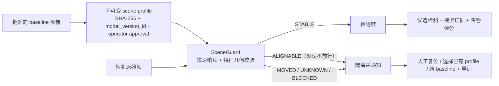

# 摄像机移动防护与录制案例识别方案（2026-07-13）

> 审查结论：固定机位模型的安全复用问题已经有可实现方案，并已接入代码；
> SceneGuard 安全门可进入集成验证。完整识别目标当前仍为 **NO-GO**，原因是
> 现有真实视频尚未同时满足覆盖率、误报、召回和延迟门槛，不能以“隔离后没有误报”
> 冒充检测成功。

## 1. 问题与边界

Argus 当前的异常模型和背景类检测器隐含“摄像机机位固定”假设。摄像机被移动、
重连到另一视频源、焦距变化或分辨率变化后，旧 baseline、PatchCore memory bank、
MOG2 背景和时序轨迹都可能失效。因此必须在每次使用旧模型前验证：

1. 当前画面是否仍属于已批准的摄像机姿态；
2. 该姿态是否与当前运行模型版本精确绑定；
3. 场景不可用期间是否确实停止检测，并清空所有旧时序状态；
4. 回归报表是否同时报告“检测可用覆盖率”，防止通过长期停检降低误报率。

录制视频必须通过生产 `DetectionPipeline` 回放，而不是只跑单个异常分数。参考画面
只能由操作者明确选择；线上运行禁止把某一帧自动学习成新参考。

## 2. 已实现的方案



### 2.1 场景身份与几何判断

- 对每帧先运行低分辨率边缘重叠和相位相关哨兵；检测到位移时，同一帧升级为
  ORB/SIFT 特征匹配和 USAC_MAGSAC/RANSAC 单应性估计。
- 完整校验审计匹配数、内点数/比例、空间覆盖、重投影误差、可见重叠率、中心位移、
  最大角点位移、旋转和尺度变化。
- 默认 `STABLE` 门槛为位移不超过 3 px、最大角点位移不超过 3 px、旋转不超过
  0.10°、尺度变化不超过 0.003。
- `ALIGNABLE` 表示几何上可配准，但默认 `allow_alignable: false`，因此不使用旧模型；
  只有完成现场标定和独立回归后才允许开启。
- `MOVED`、`UNKNOWN`、`BLOCKED` 和运行异常均立即 fail closed；恢复需要连续 N 次
  新鲜完整几何校验，缓存结果不能累计恢复计数。
- 分辨率变化直接判 `MOVED`。摄像机重连或 stream identity 变化会保留批准参考，
  但强制重新完成 N 次确认，不能沿用重连前的安全状态。

### 2.2 参考与模型绑定

- Scene profile 只能从已经存在的 baseline 文件创建，保存参考文件 SHA-256；不接受
  `ndarray` 或线上帧作为隐式学习入口。
- 激活 profile 必须提供 `model_version_id`。运行时 profile、baseline hash 或模型版本
  任一不匹配即不加载参考，旧模型不得运行。
- `active` 只表示该隔离 profile store 当前选中了哪个姿态，不等于获得生产授权。
  创建生产 profile 还必须显式传入 `--operator-approved`；缺少该字段、值为 false，或
  旧 profile 没有该字段时，回放可以继续用于诊断，但 `reference_approved` 和发布契约
  必须 fail closed。通用 `--metadata-json` 不能设置这个授权位。
- 当 `require_profile_model_binding: true` 时，没有 active profile 会直接隔离；配置的
  单张参考或 baseline fallback 不能绕过版本绑定。旧部署升级前必须先执行第 6 节的
  profile 创建/激活步骤。
- 模型热切换与 profile 重新解析位于同一处理锁内；要求 CUDA 的部署必须发布
  `model.pt` 并使用 `torch-cuda`，不能以 OpenVINO XML 静默回退。
- 进入或离开隔离状态时，MOG2、persistent change、water/plume、simplex、告警评分、
  物理轨迹和微振动配准状态全部重置；只允许使用批准参考重新初始化。

### 2.3 录制视频回归

`pipeline_video_eval.py` 使用独立解码器从头回放视频。用于发布验收时，配置中必须已有
active scene profile；调用参数中的 profile ID、参考图解码后 SHA-256、绑定模型版本和实际
加载 artifact SHA-256 必须逐项一致，而且 active profile 的不可变 metadata 必须包含显式
`operator_approved: true`。临时指定参考图、从被测视频抽参考帧、自动发现旧模型、合成模型
身份或未授权的 active 验证 profile 只允许诊断，不能获得发布批准。每一条记录都包含
SceneGuard 状态，报表聚合：

- usable/blocked 帧数与 usable coverage；
- 各场景状态计数；
- 阻断时长、最长连续阻断和状态切换次数；
- 最终 pipeline 告警、候选决策、抑制原因、FP/hour、event recall 和 P95 delay。

回归验收默认要求 `scene_guard_usable_coverage_ratio >= 0.99`，并同时校验所有已处理帧
与 score-eligible 帧两个口径，不能用 warmup/ignore 掩盖场景不可用。该门槛可通过
`--min-scene-guard-coverage` 调整，但正式发布值必须事先固定，不能在看完结果后降低。
每个已评估帧还必须有 `enabled=true` 的 SceneGuard 观测；guard 被禁用、旧报告缺字段或
观测数与 scored frames 不一致均判失败，不能把 `disabled + usable` 计成受保护覆盖率。

## 3. 当前验证证据

### 3.1 摄像机移动判断

| 案例 | 结果 |
| --- | --- |
| 真实负样本约 746 秒处永久构图跳变 | quick shift 13.07 px；同帧完整校验判 `ALIGNABLE`，最大角点位移 24.35 px；默认立即隔离 |
| 合成 2% 中心缩放 | `ALIGNABLE`，不再被中心位移指标误判为 `STABLE` |
| 合成 0.8° 旋转 | `ALIGNABLE` |
| 合成 2 px 平移 | `STABLE` |
| 分辨率变化 | `MOVED` |

1080p 单路实测：快速哨兵平均 2.818 ms、P95 3.362 ms；完整校验平均
30.670 ms、P95 33.980 ms。按 60 FPS 下每秒 59 次 quick + 1 次 full 估算，平均
约 3.282 ms/帧。完整校验仍会形成超过 16.67 ms 的周期尖峰，严格零丢帧的 60 FPS
部署应进一步异步化或降采样，但这不改变 fail-closed 正确性。

### 3.2 可用性风险

严格单参考策略在现有 30 分钟 negative 视频的 60 个稀疏采样中，仅 11 个
`STABLE`、49 个 `ALIGNABLE`，约 330 秒后开始出现缓慢姿态/尺度漂移。这说明：

- 当前实现能够安全停止错误模型；
- 当前单 profile 数据却不足以保证持续检测；
- 必须增加经批准的多个机位 profile，或者固定相机后为新姿态重新采 baseline 和训练；
- 在解决覆盖率之前，整体系统不能宣布 GO。

### 3.3 现有静态候选确认不足

用已录制的 10 个静态事件扫描单一结构阈值时，阈值 0.20 可保留 10/10 召回，
但只能拒绝约 45.1% 的正常候选框；默认 0.30 已漏掉 1 个事件；要消除已知强反光
误报需要高于约 0.75，此时事件召回约 30%。因此不存在一个结构阈值可以同时满足：

- FP <= 2 次/小时/路；
- 静态事件 recall >= 95%；
- P95 delay <= 10 秒。

静态确认应继续处于 `shadow`，不能直接切到 `enforce`。

## 4. 完成识别目标的算法路线

### Phase A：复用当前 PatchCore 热力图（优先，1.5–2.5 人日）

先不训练新网络。暴露模型尺度一致、未经逐帧 min-max 破坏的 raw anomaly map，针对
每个 persistent candidate 记录并校准：

- 全局异常分数；
- candidate 内 raw-map P95 与异常面积比例；
- candidate P95 减外围 context-ring P95；
- 热区能量落在 candidate 中的比例。

融合规则采用“模型证据必需 + 空间轨迹连续二取二”：两次评估相隔 0.4–2 秒，bbox
IoU >= 0.5；任一次失败即清零；scene/profile/model 改变或 SceneGuard 隔离时立即清空。
正式回放必须模拟生产分析率，例如目标 5 FPS 时，30 FPS 素材使用
`sample_every=6`，不能用 0.5–1 FPS 的稀疏抽样验收延迟。

### Phase B：按 scene profile 训练候选 ROI PatchCore（推荐生产路线，额外 4–6 人日）

gpu-validation 的真实视频回放已经证明 Phase A 仅靠几何归一化无法过误报门槛，因此生产实现
应进入本阶段：不先研发新的监督网络，而是复用现有 Anomalib PatchCore，为每个
scene profile 建独立正常 ROI memory bank。相机移动后不自动信任新画面，而是创建新
profile、采集经人工确认的正常样本、训练并校准新 memory bank，再单独发布：

- 每 profile 2,000–5,000 张正常 ROI；约 60% 来自高价值误报轨迹，40% 来自稳定
  负片的分层网格裁剪；
- 以候选中心裁正方形，上下文边长为 `clamp(2 * max(w, h), 96, 1024)`，缩放至
  256x256；模型高分还必须落在候选中心区域；
- 按完整录制 session 拆分 train/calibration，最终 test 使用独立语料；禁止随机拆相邻帧
  或把同一 session 切成不同角色造成泄漏；
- 只在 persistent candidate 出现时批量推理，避免逐帧增加 GPU 成本；
- 正样本只用于校准和最终验收，禁止把未确认线上画面自动加入正常 memory bank。

PatchCore 的正常 patch memory bank 与局部异常定位适合这个阶段；实现依据见
[PatchCore CVPR 2022](https://openaccess.thecvf.com/content/CVPR2022/html/Roth_Towards_Total_Recall_in_Industrial_Anomaly_Detection_CVPR_2022_paper.html)、
[Amazon 官方实现](https://github.com/amazon-science/patchcore-inspection) 和
[Anomalib PatchCore](https://github.com/open-edge-platform/anomalib/blob/main/src/anomalib/models/image/patchcore/README.md)。

仓库中的 baseline 构建器已把这条数据契约落成 `argus.scene-profile-baseline.v2`：每个
源视频必须有绑定其 SHA-256、camera、session、审核人和带时区审核时间的完整正常视频
审核；至少两个独立录制 session 才能进入训练，完整 session 分配给 train 或 calibration，
单 session 只能标记为 `diagnostic_only`。最终 test 始终来自另一个从未参与训练/调参的
regression corpus。`ModelTrainer` 必须按清单角色复制样本，不能再次随机拆帧。

当前构建器仍使用 OpenCV 解码，它不能可靠区分 clean EOF 与解码错误，也不能保留 VFR
时间戳，所以 v2 产物明确为 `release_eligible: false`，只够作为离线训练输入。正式发布还需
补充可审计的 FFmpeg/PyAV 解码证据；回归和发布两层门禁都会拒绝把当前产物冒充生产证据。
`v2` 的 schema 契约固定要求 `decoder_evidence.sufficient_for_model_release: false`，不能靠把
字段改成 `true` 升格；严格解码器落地时必须发布新的 `v3` schema，并原子更新 baseline
构建器、回归绑定器和生产发布证据校验器。三者未同时升级前，production 始终为 NO-GO。

### Phase C：少样本特征模型 challenger

只有 ROI PatchCore 仍无法同时过线时，才在同一独立语料上加入以下 challenger，不能
根据公开工业数据集成绩直接替换生产模型：

- [RegAD（ECCV 2022）](https://www.ecva.net/papers/eccv_2022/papers_ECCV/papers/136840300.pdf)
  用特征级配准和少量正常 support image 估计新场景正常分布；其
  [官方代码](https://github.com/MediaBrain-SJTU/RegAD) 可作为“新 profile 快速适配”原型；
- [AnomalyDINO（WACV 2025）](https://openaccess.thecvf.com/content/WACV2025/html/Damm_AnomalyDINO_Boosting_Patch-Based_Few-Shot_Anomaly_Detection_with_DINOv2_WACV_2025_paper.html)
  是训练免费的 DINOv2 patch nearest-neighbor 少样本方法，适合作为 1/2/4/8-shot
  对照基线；[官方代码](https://github.com/dammsi/AnomalyDINO)；
- [VSAD（AAAI 2026）](https://ojs.aaai.org/index.php/AAAI/article/view/37299)
  说明“只在像素层做一次 Homography”不足以消除视角域偏移，而多层特征对齐加正常
  prototype memory bank 更有潜力；但论文面向多视角工业物体、代码尚未公开，模型也较重，
  因此只作为研究 challenger，不作为当前交付依赖；
- [LightGlue（ICCV 2023）](https://openaccess.thecvf.com/content/ICCV2023/papers/Lindenberger_LightGlue_Local_Feature_Matching_at_Light_Speed_ICCV_2023_paper.pdf)
  /SuperPoint 只在 ORB/SIFT 因低纹理或光照变化无法可靠判定姿态时替换匹配器。它提升
  scene identity 和 Homography 质量，但不负责判断异常候选真假。

选择顺序固定为：per-profile ROI PatchCore → AnomalyDINO/RegAD 离线 challenger →
只有 challenger 在同一冻结语料显著过线，才考虑产品化。Dinomaly/VSAD 这类更重模型
不应在证据不足时直接引入主链。

## 5. GO / NO-GO 门槛

所有指标必须在同一发布模型、同一 scene profile 集和生产 pipeline 回放下同时满足：

| 指标 | 门槛 |
| --- | ---: |
| SceneGuard 稳定预期区间 usable coverage | >= 99% |
| Scene profile 人工授权 | 每段均为 active profile 且 `operator_approved: true` |
| 负样本最终告警 FP | <= 2 次/小时/路 |
| 静态异物事件 recall | >= 95% |
| P95 检测延迟 | <= 10 秒 |
| 最终独立测试集 | >= 2 小时正常视频、>= 20 个静态异物、>= 20 个 projectile；每段唯一 session 且未参与训练/调参 |
| 稳定性 | 72 小时 soak 无崩溃、持续内存增长或静默模型降级 |

高速小物体若仍是产品承诺，必须另采 1920x1080 60 FPS 视频并单独定义召回门槛；
当前三段素材均为 30 FPS，不能据此证明 60 FPS 高速目标能力。

正式回归的统计口径也必须冻结：`fp_gap_seconds=60`、`warmup_seconds=30`、普通有效回放
`>=5 FPS`、projectile 源视频和有效回放 `>=59 FPS`、SceneGuard coverage 门槛 `=0.99`。
这些参数只允许在诊断报告中调整；任何偏离都会令发布 artifact binding 失败，不能靠扩大
FP 合并窗口、延长 warmup 或降低采样门槛得到 GO。每个语料条目还必须声明唯一、非空的
`source_session_id`，并与 baseline 的训练/calibration session 不重合；相邻正样本区间按同一
事件合并，不能把一个连续事件切成多段凑够数量。

## 6. 操作流程

新姿态上线时，先人工确认正常 baseline，再创建与模型绑定的不可变 profile：

```powershell
.\.venv\Scripts\python.exe scripts/create_scene_profile.py `
  --camera-id validation_camera_01 `
  --profile-id pose-front-v003 `
  --reference data/baselines/validation_camera_01/default/v003/normal.jpg `
  --model-version-id model-v003 `
  --model-artifact data/models/model-v003/model.pt `
  --operator-approved `
  --activate
```

隔离验证 profile 可以激活，但必须显式使用 `--validation-only`，并在需要激活时同时给出
`--allow-validation-only-activation`；不能通过通用 metadata 注入授权字段。此时输出会明确显示
`operator_approved: false`，回放报告的技术身份/几何诊断仍可使用，而
`scene_profile_operator_approval` 和 `trusted_scene_reference` 发布门必定失败：

```powershell
.\.venv\Scripts\python.exe scripts/create_scene_profile.py `
  --camera-id validation_camera_01 `
  --profile-id validation-only-20260713 `
  --reference data/baselines/validation_camera_01/default/v001/baseline_00000.png `
  --profiles-dir data/validation-runs/20260713/scene_profiles `
  --model-version-id phase2-patchcore-v002 `
  --model-artifact data/exports/phase2_patchcore_v002_torch_cuda_20260613_170400/validation_camera_01/default/weights/torch/model.pt `
  --validation-only `
  --activate `
  --allow-validation-only-activation
```

摄像机回到另一个已经训练并批准的姿态时，不重新采集线上帧；先停止该路检测，再按
绑定版本原子切换已有 profile，并部署同版本模型，随后由启动/重连确认门重新放行：

```powershell
.\.venv\Scripts\python.exe scripts/activate_scene_profile.py `
  --camera-id validation_camera_01 `
  --profile-id pose-side-v002 `
  --model-version-id model-side-v002 `
  --model-artifact data/models/model-side-v002/model.pt
```

以生产 pipeline 回放真实视频并启用全部验收门：

```powershell
.\.venv\Scripts\python.exe scripts/run_regression_suite.py `
  --manifest data/regression/manifest.yaml `
  --evaluation-mode pipeline `
  --model data/models/model-v003/model.pt `
  --model-version-id model-v003 `
  --sample-every 6 `
  --min-scene-guard-coverage 0.99 `
  --fail-on-acceptance `
  --output-dir data/regression/reports/model-v003-pipeline
```

当前判定：**SceneGuard 安全门 GO（集成验证）；静态识别 enforce NO-GO；高速小物体
NO-GO；完整生产目标 NO-GO。**

正式回归的 incident 合并间隔、warmup、SceneGuard 门槛和普通/projectile 回放 FPS 已
固定为发布契约。CLI 覆盖仍可用于诊断，但报告会标记 non-canonical，不能作为发布证据；
相邻或重叠正标注会先合并，不能用切碎时间窗膨胀事件数。

## 7. Phase A 实施状态（2026-07-13）

Phase A 的 shadow 基础链已经落地：

- `AnomalyResult` 同时保留旧显示热图和 Argus 逐帧 min-max 之前的模型输出；只有
  有限、同输出空间且明确标记可比较的 map 才进入候选证据；SSIM、ensemble 混合空间、
  minmax-broken raw 路径均 fail-closed；
- 候选证据直接在模型 map 坐标计算 frame score、ROI P95、context-ring P95、二者差值、
  热区比例和能量比例，不将 1080p 图为每个候选重复放大；
- 校准 ID 绑定 camera、model version、artifact SHA-256、scene profile、解码后 reference
  SHA-256、backend、output space、模型输入链配置、person-masked/unmasked 变体和 multiscale
  配置；同时绑定 raw-output 变换、有限 map 合并、ROI/context、时序确认、连通域归因算法
  契约和 anomalib/numpy/OpenCV/OpenVINO/torch 版本；加载/热更新前后 artifact 指纹不一致时
  立即清空绑定和时序票；ID 或阈值缺失时状态为 `uncalibrated`，`would_accept=null`；
- 模型必需融合采用 structure AND model，再进行同位置连续确认；默认 2 次、IoU >= 0.5、
  0.4–2.0 秒。未在本帧实际观察到的 retained track、person skip、timeout、缺 map、场景/
  profile/model 切换均不能提供第二票；
- 默认配置仍为 `shadow` 且阈值为空，所以生产候选和告警不受影响。`enforce +
  model_required` 在缺校准、阈值不完整或候选抽样时会被配置校验拒绝；
- 候选拒绝不会再被旧的全局 anomaly 通道无条件旁路：归因使用 persistent change 的精确
  连通域 support mask，而不是外接 bbox；混合 accepted/rejected 帧只清除 rejected-exclusive
  的显示证据，accepted、unavailable 和重叠区域优先保留，独立热点也保留。只有模型热区全部
  被已拒连通域解释、没有受保护或独立热点且 Simplex 未触发时，enforce 才整体抑制重复通道；
  shadow 只记录 would-remove 诊断。该分区行为绑定
  `connected-component-partitioned-map-overlap-v3`，旧校准不能复用；
- `skip_frame_on_person` 现在只停用 appearance-model 通道，不再整帧返回；Simplex、水迹、
  烟雾和非人物 YOLO 继续运行。非人物目标只有在每相机显式 `alert_class_ids` 白名单内且超过
  `alert_min_confidence` 时，才可用自身置信度形成独立对象安全分数；默认白名单为空，未列入/
  阈值下目标不积累告警，且 bbox 必须与对应 include zone 相交；
- 多通道不再压入一个可变的全局 score/map/type 决策：appearance 保留独立 score/map，
  Simplex、确认后的静态变化、水迹、可见烟雾和安全对象均以 `type + exact score + bbox`
  的 localized incident 进入区域评分；每个 `(zone, detection type)` 分别累计 CUSUM、
  分别抑制和分别发告警，同一区域的 0.99 appearance 不会把 0.60 water 抬成 0.99，
  water/plume 也不会相互提供时序票。全通道聚合 map 仅用于总览显示，不进入事件评分或
  spatial-continuity；告警热图/continuity mask 均来自该通道的区域化 support；
- Simplex 的每个 `static_region` 都会生成局部 incident；多个 include zone 时，无模型热图
  的 fallback 分数不会再广播到所有区域；
- 同帧多个区域或同一区域多个通道产生的告警全部进入回调、事件总线、录像固化和持久化；`process_frame()`
  仍返回最高优先级 primary alert 以保持接口兼容，其余告警记录在同帧 alerts 证据中；
- 每个告警热图会清零本区外像素；localized 去重至少按 camera + zone + detection type +
  空间位置区分，不允许一个区域/通道的告警压掉另一个独立事故；
- 当前 open-vocabulary classifier 仍只返回一个 frame-global 结果，因此只允许读取/修改
  appearance 通道，并在多 include-zone 配置中 fail-closed 跳过；静止轨迹抑制同样只处理
  appearance。完成 per-component bbox 分类之前不得用它抑制或佐证 Simplex、水迹、烟雾等
  独立事故；appearance 推理 timeout/异常也只标记该通道 unavailable，独立通道继续评分；
- ensemble 与 shared multi-class Dinomaly 当前不能提供安全的 artifact 生命周期绑定，配置
  守门禁止其与 `enforce + model_required` 组合；shadow 中也不把 shared map 标成可校准；
- 离线 pipeline 保留全部处理帧，并用 `score_eligible` 排除 warmup/ignore；报告同时输出
  all-frame 与验收口径 SceneGuard coverage、map extraction coverage、calibrated evaluation
  coverage、外层 structure+model+temporal 决策和 anomaly attribution。仅 `evaluated` 进入
  接受/拒绝分母，skipped、uncalibrated、rate-limited 不会被误算成模型拒绝；若生产启用
  sensor fusion 或 cross-camera，而语料没有对应同步输入，production parity 直接失败；
- 回归发布门要求完整 manifest、每段均标记 `independent_test` 且有唯一
  `source_session_id`、至少 2 小时正常素材、至少 20 个独立 `static_foreign` 事件和 20 个
  独立 projectile 事件，且静态类 recall >= 95%。两类事件不能互相补足；候选
  机制必须实际运行于 `enforce + model_required`，校准 ID 全语料一致、map/校准覆盖率 >= 99%、
  contract violation 和 unavailable 均为零。每段还必须由 active profile 提供显式
  `operator_approved: true` 证据；旧报告、shadow、未授权验证 profile 或只跑 manifest 子集
  都不能通过发布门。

当前仓库素材盘点结果仍不足以执行有效生产验收：

- 正常视频仅 30 分钟，低于 2 小时；
- `static_foreign` 仅 10 个事件，低于 20 个；现有 projectile 10 个不能替代；
- 三段视频均未标记 `independent_test`，属于既有调试/调参素材；
- `data/models/phase2_patchcore_20260613/validation_camera_01/default/` 只有 calibration，缺少
  目标 `.pt`/`.xml` artifact；其他摄像机模型不能冒充该相机模型；
- `data/scene_profiles/` 尚无该相机已批准并绑定目标模型的 active profile；
- projectile 素材为 30 FPS，不能验证 1920x1080 60 FPS 高速目标承诺。

下一动作已经从“开发链路”变为“用已录视频生成 per-profile/model 校准阈值并跑独立
验收”。在真实回放同时满足第 5 节全部门槛之前，仍不得切换 `enforce`；若 raw ROI
证据不可分，再进入 Phase B 的 ROI PatchCore，而不是继续堆结构阈值。

## 8. gpu-validation 真实 CUDA 回放结论（2026-07-14）

隔离运行使用 RTX 3060、`torch-cuda` 和实际 `model.pt`，三段视频全部读到 EOF，处理
1800 / 1200 / 780 个采样帧，推理失败为 0。结果把两个问题明确分开：

1. 严格 `allow_alignable: false` 能安全阻断不再匹配训练姿态的画面，但验收帧
   SceneGuard usable coverage 只有 7.7507%，静态和 projectile 事件召回均为 0；这证明
   fail-closed 有效，但不能把“停检”算成识别成功。
2. 诊断配置唯一打开 `allow_alignable: true`。冻结代码在每个 ALIGNABLE 帧上实际调用
   `warpPerspective`，把画面变换到批准参考坐标，并以参考像素填充不可观测边界后再进入
   downstream pipeline；它不是“只放行未对齐原图”。该实验 usable coverage 为 99.898%，
   静态事件 10/10、P95 延迟 4 秒，但总体 FP 为 6.9723 次/小时，纯负片为 8.1356 次/小时，
   且静态事件窗口出现错误 projectile 通道告警。

因此，**直接复用旧模型的 Homography 路线 NO-GO**。它证明几何归一化能恢复召回，
却不能消除插值、遮挡/新可见区域、光照与 PatchCore 正常分布变化造成的误报。可完成目标的
生产方法是：

`SceneGuard 隔离 → 匹配/创建 scene profile → 人工批准正常采集 → per-profile PatchCore
重训与阈值校准 → 独立视频回归 → 72 小时 soak → 原子发布`。

Homography 仍保留两种用途：作为 SceneGuard 的姿态证据；或在同一 profile 的小幅抖动内
做受约束归一化。它不能跨 profile 自动授权旧模型，也不能在未过独立误报门槛时开启。

旧训练数据也不能用来弥补验收缺口。gpu-validation 现存 `_split` 目录将同一段 30 分钟
negative 视频的 1,800 个每秒抽样随机分成 train 1,440 帧和 val 360 帧；两个集合都贯穿
0–1,799 秒，并同时覆盖机位变化前后。因此该拆分存在相邻帧/同 session 时间泄漏；
旧目录与当前 export 的准确关联也没有不可变清单证明。新模型必须按完整录制 session
拆分，并使用从未参与训练或调参的视频作最终验收。

为防止重新制造同类泄漏，新的 baseline 工具要求至少两个经人工审核、声明为不同
`source_session_id` 的正常录制 session，并生成完整 session 的 train/calibration 角色。
当前只有一段正常视频，不能诚实地伪造第二个 session，因此尚不具备重新训练条件；还需
另录至少一个独立正常 session。即使训练完成，当前 OpenCV 解码证据也会让 production
发布继续保持 NO-GO，直到严格解码证据链补齐。

发布还需要可信的 72 小时 soak 生产者。当前门禁要求 v2 soak 的带时区时间窗、绑定的
原始 telemetry、连续性证据和受保护密钥验签；仓库尚未实现可信验签器，因此会明确拒绝
自报 JSON。现阶段可以完成算法训练和隔离回归，但不能诚实地完成 production promotion；
需先补严格视频解码器与 soak 签名采集器，随后再跑完整独立验收。
